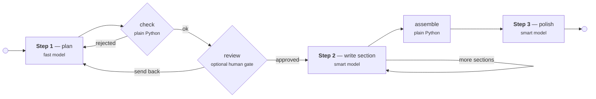

# Prompt chaining

Turn a raw topic into a finished blog post by splitting one large request into a sequence
of small ones, where each step's output is the next step's input.

```bash
mise run demo prompt-chaining --topic "Why Python developers should learn Rust"
```

## The pattern



**Step 1 — outline.** One cheap call produces 4–5 headings, each with a one-sentence
summary. It returns a typed `Outline`, not prose, because the next step needs to be able
to *check* it.

**Step 2 — write each section.** One call per section, given the whole outline for context
and one heading to write. The chain loops back into the same node until every heading has
a body.

**Step 3 — review and polish.** One call over the assembled draft: remove repetition
between sections, smooth the seams, add a closing section.

## Why not one prompt

This is the argument the demo is built to make, so the code makes each part of it visible:

- **Smaller scope per step.** The outline call is told to produce headings and forbidden to
  write bodies. A single mega-prompt has to hold every instruction at once, and drifts.
- **You can check the work in the middle.** `check_outline` is a plain Python node: wrong
  number of headings, an empty summary or two identical titles send step 1 back with the
  reason attached. Catching a bad plan costs one cheap call; catching it after the full
  draft costs the whole run. With `--review`, a person makes that call instead.
- **A failure has an address.** When the output is wrong you know which step produced it,
  because each step's output is a separate, inspectable artifact.
- **Each step can be tuned on its own.** Here that is temperature — 0.4 for the outline,
  0.7 for prose, 0.3 for the edit. Taken further it is a different *model* per step, cheap
  for planning and strong for writing, which is what
  [`apps/bifrost-gateway`](../bifrost-gateway/README.md) is for.

This is *sequential* — each step depends on the one before. That is what separates it from
parallelization, where independent prompts run at once and their results are merged.

In LangGraph terms it is the most basic shape there is: a linear graph where each node is
one LLM call and state flows along the edges. The two loops (retry the outline, write the
next section) and the human gate are the only departures from a straight line.

## Running it

```bash
# Default topic, default models.
mise run demo prompt-chaining

# Pick a topic, write in Vietnamese, save the result.
mise run demo prompt-chaining \
  --topic "Lợi ích của việc học Rust cho dev Python" \
  --language Vietnamese \
  --output /out/rust-for-python-devs.md

# Approve the outline yourself before any prose is written.
mise run demo prompt-chaining --review
```

`mise` claims `--help` for its own task help, so to see the demo's, invoke it directly:

```bash
cd apps/prompt-chaining
../../scripts/with-secrets.sh docker compose run --rm demo --help
```

`--output` paths under `/out` land in `apps/prompt-chaining/out/` on the host.

### Options

| Option | Default | What it does |
| --- | --- | --- |
| `--topic`, `-t` | *Why Python developers should learn Rust* | What the post is about. |
| `--language` | `English` | Language the post is written in. |
| `--words` | `200` | Target words per section. |
| `--sections` | `5` | How many sections to plan. |
| `--review` | off | Pause after the outline and ask you to approve it. |
| `--output`, `-o` | — | Write the finished post to a file. |

### The model

One model runs every step:

```bash
MODEL=gemini-3.5-flash-lite   # the default
```

The chain calls Google directly through `langchain-google-genai` — there is no LLM gateway
here. A gateway the chain never routes through would be a second moving part in a demo
about prompt structure. If you want to see what a gateway buys you, that lives in
[`apps/bifrost-gateway`](../bifrost-gateway/README.md).

What *does* vary per step is temperature — 0.4 for the outline, 0.7 for prose, 0.3 for the
final edit. That is the smallest version of the same idea: splitting one big prompt into
several is what lets each step be tuned at all. Using a *different model* per step —
cheap for planning, strong for prose — is that idea taken further, and it is one of the
things the gateway app exists for.

### Running without Docker

The demo is an ordinary console script and needs nothing but the key:

```bash
cd apps/prompt-chaining
uv sync --extra dev
GEMINI_API_KEY=... uv run prompt-chaining --topic "..."
```

Or let the wrapper fetch the key so it never lands in your shell history:

```bash
../../scripts/with-secrets.sh uv run prompt-chaining --topic "..."
```

## Tests

`tests/test_graph.py` covers the parts that hold the chain together — the outline gate, the
routing and the assembly — all of which are plain Python, so they run in CI with no
gateway, no key and no network:

```bash
mise run check prompt-chaining     # every gate, this app only

cd apps/prompt-chaining && uv run pytest   # just the tests
```

## Notes

- Step 1 uses `with_structured_output(Outline)`, which needs a tool-calling-capable model.
  The default qualifies; if you point `MODEL` at one that does not, that call is where it
  will fail.
- After `--sections` retries the chain warns and carries on with an imperfect outline
  rather than throwing the run away. The warning names the reason, so the log still tells
  you which step misbehaved.
