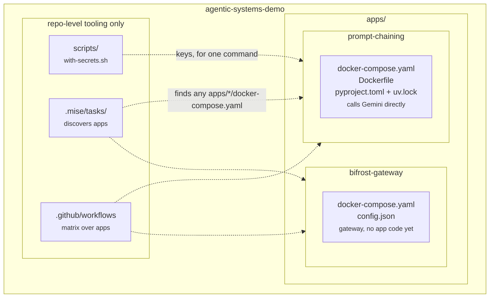

# How the repo is put together

Each app under `apps/` is one agentic-system pattern, and each is a self-contained thing
you can run with a single command.

## Isolation is the organising rule

An app owns everything it needs: its dependencies and lockfile, its Dockerfile, whatever
infrastructure it runs, and its own ruff/mypy/pytest settings. Nothing in an app's
`docker-compose.yaml` or `Dockerfile` reaches above its own directory.

That is a deliberate trade. It costs some duplication — every app repeats a block of lint
config and the few small modules under `src/` that are not pattern-specific — and buys the
property that matters here:
an app can be moved into its own repository and pulled back in as a **git submodule**
without editing anything. A shared `packages/` directory, a workspace lockfile or a
root Dockerfile with a `DEMO_PACKAGE` build arg would each quietly make that impossible.

What is left at the repository root is tooling that operates *on* apps rather than
belonging *to* one: the secrets wrapper, the task scripts, CI, and these docs. All of it
discovers apps by globbing `apps/*/pyproject.toml`, so adding an app — or mounting one as
a submodule — needs no edit anywhere.

## An app brings only what it needs

There is no shared infrastructure tier. `prompt-chaining` runs every step on one Gemini
model and calls Google directly — one container, no gateway, nothing to wait for on
startup. `bifrost-gateway` is the opposite shape: an LLM gateway with no app code yet.

That split is on purpose. An earlier version put a Bifrost gateway in front of
`prompt-chaining`, and it was the wrong call: a reader learning about prompt structure had
to read Docker plumbing for a component the chain never actually routed through. A gateway
earns its place when a demo needs several providers behind one client, per-step model
routing, or one request log across a whole run — see
[apps/bifrost-gateway](../apps/bifrost-gateway/README.md). Until a demo needs that, it does
not get one.

The tooling supports both shapes: an app is a directory under `apps/` with a
`docker-compose.yaml`, and it *additionally* gets the Python gates if it has a
`pyproject.toml`.

## Inside an app

An app is an ordinary installable Python package with a console-script entry point, which
is why `docker compose run --rm demo --topic '...'` works with no `PYTHONPATH` in sight.
The console script is the image's `ENTRYPOINT`, so arguments append rather than replace.

Model choice is configuration, not code: `prompt-chaining` reads `MODEL` from the
environment and every step goes through one `chat_model()` factory, so re-pointing the
chain is an env var.

## What CI does

Code quality only — see `.github/workflows/ci.yml`. This repo builds no images for a
registry: each app is built locally by its own compose file, so there is nothing to push
and the org's reusable build-and-push workflow does not apply.

A `discover` job globs `apps/*/` and feeds a matrix, so each app gets its own job and its
own pass/fail. An app with a `pyproject.toml` gets `ruff` (lint + format), `mypy`,
`pytest`, `bandit` and `pip-audit`; every app gets `docker compose config`. Repo-wide:
`shellcheck` over the secrets and task scripts, and `markdownlint`.

The tests are offline by design. Every graph keeps its checkable logic — validation gates,
routing, assembly — in plain Python nodes, so CI needs no gateway, no key and no network.
