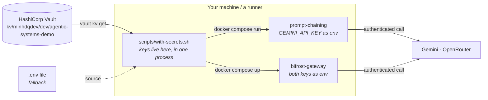

# Where the API keys live

This repo needs two credentials:

| Key | Used by |
| --- | --- |
| `GEMINI_API_KEY` | `prompt-chaining` (calls Google directly) and `bifrost-gateway` |
| `OPENROUTER_API_KEY` | `bifrost-gateway` only |

Wherever they end up, one rule holds: **a key reaches a process as an environment
variable, for the length of one command, and never as a file at rest or a baked image
layer.** `scripts/with-secrets.sh` resolves them, exports them into its own process, and
`exec`s the command — so they are inherited by that command and gone when it exits.

`prompt-chaining` does read `GEMINI_API_KEY` itself, via `Settings`; it calls Google
directly, so it must. An app sitting behind `bifrost-gateway` would not — the gateway
holds the credential and does the calling, and that containment is worth having when a
demo needs several providers. Neither arrangement changes how the key gets there, which is
what the rest of this document is about.



## Two backends, one entry point

Everything goes through `scripts/with-secrets.sh`. It resolves the keys, exports them into
its own process, and `exec`s the command you gave it — so the keys are inherited by that
command and disappear when it exits.

```bash
cd apps/prompt-chaining
../../scripts/with-secrets.sh docker compose up
```

`mise run demo <app>` does exactly this for you.

The backend is chosen by `SECRETS_BACKEND`, and auto-detected when it is unset:

| Backend | When it is picked | Where the keys come from |
| --- | --- | --- |
| `vault` | default, when the `vault` CLI is installed and a token or AppRole is available | `vault kv get kv/minhdqdev/dev/agentic-systems-demo` |
| `dotenv` | when there is no Vault auth but a `.env` exists | `./.env` at the repo root |
| `env` | when neither applies | already exported — CI, or a shell you set up yourself |

## Vault (recommended)

### Why

A `.env` file is a credential at rest, and its lifetime is nobody's job. It survives the
session that created it, it gets picked up by editor plugins and backup tools, it gets
copied to the next machine along with the repo, and it is one `git add -f` away from a
public commit. `.gitignore` addresses only the last of those.

Vault moves the key to a place with an owner: it is versioned, its reads are audited, the
policy that grants access is written down, and rotating a compromised key is one
`vault kv put` rather than a hunt through every machine that has a copy.

### Set it up

```bash
export VAULT_ADDR=https://vault.internal.minhdq.dev
vault login                      # or set VAULT_TOKEN
mise run vault-bootstrap         # prompts for both keys, never echoes them
```

`scripts/vault-bootstrap.sh` writes the secret, then creates the two things that make
non-interactive access possible later:

- policy `agentic-systems-demo-reader` — read on `kv/data/minhdqdev/dev/agentic-systems-demo`, nothing else;
- AppRole `agentic-systems-demo` — bound to that policy, with a 1h token TTL.

Check it worked:

```bash
mise run secrets-check
# secrets: vault (https://vault.internal.minhdq.dev :: kv/minhdqdev/dev/agentic-systems-demo)
# ok: both keys resolved (39 and 73 chars)
```

From then on, every `mise run demo ...` pulls the keys fresh from Vault. Nothing is
written to disk.

One secret serves every app. An app that grows its own provider set can be pointed at its
own path with `VAULT_SECRET_PATH` — see below.

### From a machine that cannot log in interactively

Mint a `secret_id` and hand the pair over as environment variables. The wrapper does the
AppRole login itself:

```bash
vault write -field=secret_id -f auth/approle/role/agentic-systems-demo/secret-id
```

```bash
VAULT_ROLE_ID=... VAULT_SECRET_ID=... scripts/with-secrets.sh docker compose up
```

A `secret_id` is still a credential — but a short-lived, revocable, single-purpose one
that grants read on one path, which is a strictly better thing to hand a runner than the
provider keys themselves.

### Pointing at a different path

The path is not hard-coded. To run against a different tenant or environment:

```bash
VAULT_SECRET_PATH=kv/minhdqdev/uat/agentic-systems-demo mise run demo prompt-chaining
```

## `.env` (fallback)

Nothing is wrong with this for a throwaway experiment on a laptop that has no Vault
access, and it keeps the repo usable for someone outside the homelab:

```bash
cp .env.example .env
$EDITOR .env
mise run demo prompt-chaining
```

`.env` is gitignored, and `docs/` deliberately contains no instruction that would put it
anywhere else. If you use this backend, delete the file when you are done with it.

## Adding a third key

Three places, in this order:

1. `apps/<app>/docker-compose.yaml` — add `NEW_KEY: ${NEW_KEY:?...}` to the service that
   needs it.
2. For a gateway app, `apps/<app>/config.json` — add the provider with
   `"value": "env.NEW_KEY"`.
3. `scripts/with-secrets.sh` — add it to `REQUIRED_KEYS`.

Steps 1 and 2 are per app. Step 3 is shared: `REQUIRED_KEYS` is what the wrapper guarantees
before it hands off, so a key that only one app needs still has to be listed there — or
give that app its own `VAULT_SECRET_PATH` and a wrapper of its own.

Then `vault kv put` the new key alongside the existing ones (`vault kv put` replaces the
whole secret, so pass every key, or use `vault kv patch`).

## Running this on Kubernetes

An AppRole is the right answer for a laptop or a runner. For a workload in the homelab
cluster it is not — the platform standard is Vault Agent injection against the pod's
service account, so no credential is ever handed to the workload at all:

```yaml
annotations:
  vault.hashicorp.com/agent-inject: "true"
  vault.hashicorp.com/agent-address: "https://vault.internal.minhdq.dev"
  vault.hashicorp.com/agent-init-first: "true"
  vault.hashicorp.com/auth-path: "auth/kubernetes"
  vault.hashicorp.com/role: "agentic-systems-demo-dev"
  vault.hashicorp.com/agent-inject-secret-.env: "kv/data/minhdqdev/dev/agentic-systems-demo"
  vault.hashicorp.com/agent-inject-template-.env: |
    {{ with secret "kv/data/minhdqdev/dev/agentic-systems-demo" -}}
    export GEMINI_API_KEY={{ index .Data.data "GEMINI_API_KEY" | toJSON }}
    export OPENROUTER_API_KEY={{ index .Data.data "OPENROUTER_API_KEY" | toJSON }}
    {{- end }}
```

The container then sources `/vault/secrets/.env` at startup. The Kubernetes auth role is
bound to the service account rather than to a shared `secret_id`:

```bash
vault write auth/kubernetes/role/agentic-systems-demo-dev \
  bound_service_account_names=agentic-systems-demo \
  bound_service_account_namespaces=agentic-demo \
  policies=agentic-systems-demo-reader \
  audience=https://kubernetes.default.svc.cluster.local \
  ttl=24h
```

The apps are not deployed to the cluster today; this is here so that when one is, it does
not get a `kubectl create secret` instead.

## What never happens

- No key is committed. `.env`, `*.pem` and `*.key` are gitignored, and `.env.example`
  carries placeholders only.
- No key is read from a file at run time. `Settings` takes `GEMINI_API_KEY` from the
  environment; the `.env` support in pydantic-settings is for a bare `uv run` on a
  workstation, and no container ever has such a file.
- No key is baked into an image. No app's `Dockerfile` takes a secret build arg, and none
  copies a `.env`.
- No key is logged. `Settings.gemini_api_key` is a pydantic `SecretStr`, so it renders as
  `**********` in a repr or a traceback rather than in the terminal.
- No key is printed. `mise run secrets-check` reports character counts, not values, and
  `vault-bootstrap.sh` reads with `read -rsp`.
